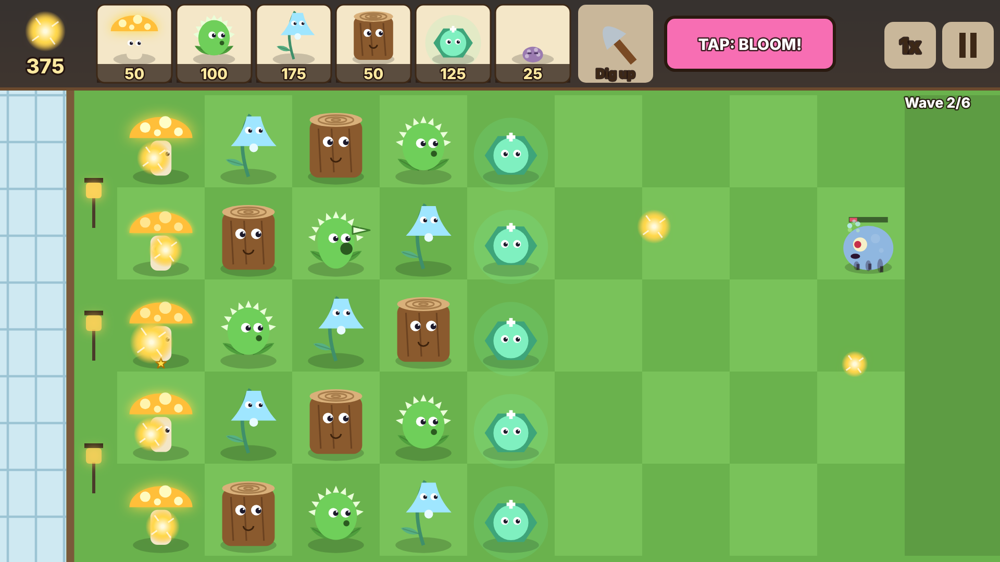

# Bloomguard 🌱

An original lane-defense strategy game for Android (Google Play) and the web.
Plant living garden **guardians** on a 5×9 grid, gather **Glow**, and stop the **Rotlings** before they put out your greenhouse lanterns.



## Features
- **10 guardians**: Glowcap (economy), Thornling, Frostbell (slows), Barkwall, Puffball (spore trap), Mossmender (healer), Lanceleaf (piercing), Stormseed (3-lane lightning), Emberroot (splash + burn), Twinbud (3-lane shooter)
- **8 Rotlings**, including armored, flying, tunneling and spawning types, plus a boss, the Rot Monarch
- **3 worlds × 5 levels**, each with its own conditions: day sky-Glow, night (no sky Glow), and wind gusts that push enemies back but blow away loose Glow
- **Endless Bloom** mode with a saved high score
- Improvements over the classic formula:
  - In-field **upgrades** (drop a card onto the same guardian, up to ★★★)
  - **Bloom Burst** super meter
  - **3 lanterns** instead of instant loss: each lost lantern knocks all enemies back
  - **2× speed**, auto-collect Glow, a 25% refund when digging up
  - The next wave comes early when you clear the field
- Field guide, loadout picker, star ratings, local saves, synthesized music and sound effects
- No ads, no tracking, no network use; works fully offline

## Original IP: why this is safe to publish
- **Everything is original.** Name, characters, creature designs, world names, level design, UI, code, art and audio were all made for this project.
- **No image or audio files from anywhere else.** All art is drawn procedurally in `www/js/art.js`, and all sound is synthesized in `www/js/audio.js`. The icon, feature graphic and screenshots are rendered from that same code (`scripts/make-assets.mjs`).
- **Game mechanics are not copyrightable.** Lane defense, resource generation and unit placement are a genre shared by many games. Specific expression is protected: names, characters, art, sounds, text and trademarks. Bloomguard reuses none of these from any existing game.
- **Keep it that way when you publish:**
  - Don't mention "Plants vs. Zombies", PopCap, EA or any other game in the store title, description or keywords. That is trademark misuse and a common reason Play rejects apps.
  - Consider renaming this GitHub repository (for example to `bloomguard`), since the current name echoes a trademark.
  - Before launch, search the Play Store and a trademark database (USPTO TESS, EUIPO eSearch) for "Bloomguard". If the name is taken, change `appName` in `capacitor.config.json`, `android/app/src/main/res/values/strings.xml`, and the `<title>` and logo in `www/`.
  - Change `appId` (`io.github.bloomguard.game`) to a package name you own **before your first upload**. It can never be changed afterwards.

## Project layout
```
www/                  the game (plain HTML/CSS/JS ES modules, no build step)
  js/data.js          guardians, rotlings, worlds, levels (balance lives here)
  js/game.js          engine: simulation, input, rendering
  js/art.js           procedural vector art
  js/audio.js         WebAudio synth sound effects + generative music
  js/main.js          menus, progression, Android back button
  privacy.html        privacy policy (hosted by GitHub Pages)
android/              Capacitor Android project (landscape, immersive full-screen)
store/                Play Store listing text, icon, feature graphic, screenshots
scripts/              asset generator + headless gameplay smoke test
```

## Run it
```bash
npm install
npm run serve          # play in a browser at http://localhost:8080
npm test               # headless bot plays all 15 levels + endless (needs Playwright)
```

## Build for Android
Requirements: Node 22+, JDK 21, Android SDK (install Android Studio).
```bash
npm install
npx cap sync android
cd android && ./gradlew assembleDebug        # app/build/outputs/apk/debug/app-debug.apk
```
Or open the project in Android Studio with `npx cap open android`.

**No local setup?** The GitHub Actions workflow (`.github/workflows/android.yml`) runs the smoke test and builds a debug APK and a release AAB on every push. Download them from the run's **Artifacts**.

## Publish to Google Play
1. **Create an upload key** (once; back it up, because losing it is painful):
   ```bash
   keytool -genkeypair -v -keystore bloomguard-upload.jks -alias upload -keyalg RSA -keysize 2048 -validity 10000
   ```
2. **Signing**, using either option:
   - Locally: create `android/keystore.properties` (git-ignored):
     ```
     storeFile=/absolute/path/bloomguard-upload.jks
     storePassword=...
     keyAlias=upload
     keyPassword=...
     ```
     Then run `cd android && ./gradlew bundleRelease`.
   - In CI: add repository secrets `BLOOMGUARD_KEYSTORE_BASE64` (`base64 -w0 bloomguard-upload.jks`), `BLOOMGUARD_KEYSTORE_PASSWORD`, `BLOOMGUARD_KEY_ALIAS` and `BLOOMGUARD_KEY_PASSWORD`. The workflow then produces a signed `.aab`, with `versionCode` set to the run number so it always increases.
3. **Privacy policy URL:** enable GitHub Pages (Settings → Pages → Source: GitHub Actions). The `pages.yml` workflow publishes `www/`, so the policy is at `https://<user>.github.io/<repo>/privacy.html` and a playable web version is at the root.
4. In the **Play Console** ($25 one-time developer fee):
   1. Create the app.
   2. Fill in the store listing from `store/listing.md` and upload the graphics in `store/`.
   3. Complete the content rating, data safety and target audience forms (suggested answers are in `store/listing.md`).
   4. Upload the `.aab` to Internal testing, then Closed testing. New personal developer accounts need 12+ testers for 14 days before production.
   5. Release to production.

## License
Code: MIT (see `LICENSE`). All game art and audio are generated by this code and fall under the same license.
