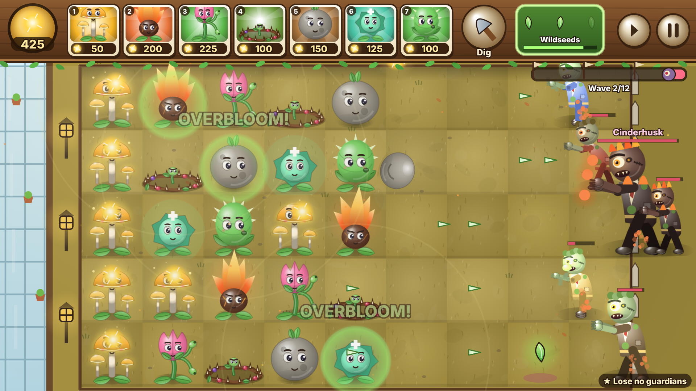

# Bloomguard 🌱

An original lane-defense strategy game for **Steam** (Windows, macOS, Linux, Steam Deck), **Android** (Google Play) and the web.
Plant living garden **guardians** on a 5×9 grid, gather **Glow**, and stop the **Rotlings** before they put out your greenhouse lanterns.



## Features
- **Story:** Wren and Moss chase the Rot Monarch across 6 worlds to recover the stolen Hearthseed, then follow the blight spores up to the sky and down to its ancient root, with illustrated dialogue scenes and a boss at the end of every world.
- **8 worlds × 6 levels (48 levels)**, picked from an illustrated world-select screen and played along a winding road map. Each world has its own rule:
  - *Dawn Greenhouse:* sky Glow
  - *Moonlit Marsh:* night, so catch fireflies
  - *Ember Orchard:* ember rain and wind gusts
  - *Frostpeak Terraces:* frozen tiles and blizzards
  - *Crystal Caverns:* mineable crystals
  - *The Rotheart:* spreading blight
  - *Skyroot Gardens:* cloud gaps you can't plant on, updrafts carrying Glow, wind gusts
  - *Mushroom Hollow:* tappable glowcaps and slowing spore storms
- **Level goals:** defend, protect the sprouts, fixed budget, or a set loadout, plus a three-star challenge on every level.
- **18 guardians** with distinct roles (producers, shooters, walls, traps, melee, snares, homing bees, lobbers, healers, buffs, ground spikes). Each has a unique **Overbloom** super powered by Wildseeds.
- **The Rotlings:** original undead "husks", gardeners raised by the blight, each with its own gear and ability: bark armour, fence-plank shields, root crawlers, spewers, mushroom sacks, burning, frostbitten and crystal-grown husks, hooded healers, kite riders, toadstool-headed snipers and hulking Mossbrutes, plus rot rats, blightmoths and the Rot Crab. Husks lose an arm when badly hurt. 8 giant bosses have their own attacks.
- **Progression:** petals and the Grove (permanent upgrades), loadout slots that grow from 6 to 8, in-battle ★★★ upgrades, 18 trophies, and an Endless mode that travels through every world.
- **Animation:** an animated, skippable intro movie; living story scenes where characters walk in, react and emote; boss entrance cinematics with title cards; an animated ending with credits.
- **Modes:**
  - *Pot Luck* mini-game: smash clay pots to find free guardians, but beware the hidden Rotlings
  - *Bonk the Blight* reaction mini-game
  - a seeded *Daily Challenge* with modifiers and a streak counter
  - a real-time *Zen Nursery*
- **Acorn economy and Store:** 5 permanent boosts. (Hats and colour skins exist in the code but are switched off for now: `COSMETICS_ENABLED` in `www/js/data.js`.)
- **Art:** clean, outline-free cartoon characters with soft shading, big readable faces and squash-and-stretch animation, all drawn in code. Every character, portrait and lawn can be **replaced with your own painted artwork** (see [Using your own art](#using-your-own-art)).
- **Lexicon:** an animated portrait for every guardian, Rotling and boss, with role badge, stat bars, description, Overbloom, lore and a strategy tip. Undiscovered entries show as silhouettes.
- **Storybook art and UI:** an animated parallax main menu with wooden signboards, a live preview of the horde waiting at your fence before each level, painterly pre-rendered lawns, soft key lighting, clouds, squash-and-stretch and pop-in animation, hit knockback, and a wave progress bar with flags.
- Controller support (Steam Deck / Xbox / PlayStation) with a stick-driven cursor. Keyboard: 1–8 pick cards, W Wildseed, Space speed, P/Esc pause.
- No ads, no tracking, no network use. Works fully offline.

## Original IP: why this is safe to publish
- **Everything is original.** Name, characters, creature designs, world names, level design, UI, code, art and audio were all made for this project.
- **No image or audio files from anywhere else.** All built-in art is drawn procedurally in `www/js/art.js`, and all sound is synthesized in `www/js/audio.js`. The icon, feature graphic and screenshots are rendered from that same code (`scripts/make-assets.mjs`). Any painted artwork you add later must also be original, with full commercial rights.
- **Game mechanics are not copyrightable.** Lane defense, resource generation and unit placement are a genre shared by many games. Specific expression is protected: names, characters, art, sounds, text and trademarks. Bloomguard reuses none of these from any existing game.
- **Keep it that way when you publish:**
  - Don't mention "Plants vs. Zombies", PopCap, EA or any other game in the store title, description, tags or keywords on Play or Steam. That is trademark misuse and a common reason both stores reject apps.
  - Consider renaming this GitHub repository (for example to `bloomguard`), since the current name echoes a trademark.
  - Before launch, search the Play Store and a trademark database (USPTO TESS, EUIPO eSearch) for "Bloomguard". If the name is taken, change `appName` in `capacitor.config.json`, `android/app/src/main/res/values/strings.xml`, and the `<title>` and logo in `www/`.

## Project layout
```
www/                  the game (plain HTML/CSS/JS ES modules, no build step)
  js/data.js          guardians, rotlings, worlds, levels (balance lives here)
  js/game.js          engine: simulation, input, rendering
  js/art.js           procedural vector art
  js/audio.js         WebAudio synth sound effects + generative music
  js/main.js          menus, story, Grove, trophies, progression, back button
  js/story.js         story script
  js/cinema.js        animated intro + ending movies
  js/bonk.js          Bonk the Blight mini-game
  js/gamepad.js       controller cursor support
  js/sprites.js       loads optional painted artwork from www/sprites/
  sprites/            your artwork + sprites.json (empty = built-in code art)
  privacy.html        privacy policy (hosted by GitHub Pages)
dev/                  developer-only tools, never shipped in the app
  art-studio.html     Art Studio: preview, normalise and export your own artwork
android/              Capacitor Android project (landscape, immersive full-screen)
desktop/              Electron shell for Windows / macOS / Linux (Steam)
steam/scripts/        SteamPipe build scripts for manual uploads
store/                Play Store listing, icon, feature graphic, screenshots
store/steam/          Steam store text + every capsule / library image
scripts/              store asset generator, art template exporter, headless gameplay smoke test
ART_GUIDE.md          full guide for adding painted artwork
```

## Run it
```bash
npm install
npm run serve          # play in a browser at http://localhost:8080
npm test               # headless bot plays all 48 levels, Pot Luck, daily challenges and Endless (needs Playwright)
npm run studio         # developer Art Studio at http://localhost:8090/dev/art-studio.html
npm run templates      # export size-correct art templates for every character to art-templates/
```

## Using your own art
Every guardian, Rotling, story portrait and world lawn can be swapped for painted artwork without
touching the game code. Anything you don't replace keeps the built-in code art, so you can do it
one character at a time.

1. `npm run studio` opens the **Art Studio**. It's a **developer tool in `dev/`**: it is not in the
   game menus and is never packaged into the Android or Steam builds.
2. Pick a character, drop in your PNG (several files make an animated idle loop; an optional attack
   image plays while shooting or biting) and compare it with the built-in art at real in-game size.
3. **Export normalised PNG(s):** the Studio trims empty space, scales characters to **512 px tall**
   with the feet on the bottom-centre (lawns to **1008 × 590 px**) and names the files for you.
4. Put the files in `www/sprites/<guardians|rotlings|portraits|backgrounds>/`, copy the JSON line
   into `www/sprites/sprites.json`, and reload. Your art is now used everywhere in the game.

Sizes, anchors, file names, animation options and originality rules are in [`ART_GUIDE.md`](ART_GUIDE.md).

## Build for Android
Requirements: Node 22+, JDK 21, Android SDK (install Android Studio).
```bash
npm install
npx cap sync android
cd android && ./gradlew assembleDebug        # app/build/outputs/apk/debug/app-debug.apk
```
Or open the project in Android Studio with `npx cap open android`.

**No local setup?** The GitHub Actions workflow (`.github/workflows/android.yml`) runs the smoke test and builds a debug APK and a release AAB on every push. Download them from the run's **Artifacts**.

## Publish to Google Play
1. **Create an upload key** (once; back it up, because losing it is painful):
   ```bash
   keytool -genkeypair -v -keystore bloomguard-upload.jks -alias upload -keyalg RSA -keysize 2048 -validity 10000
   ```
2. **Signing**, using either option:
   - Locally: create `android/keystore.properties` (git-ignored):
     ```
     storeFile=/absolute/path/bloomguard-upload.jks
     storePassword=...
     keyAlias=upload
     keyPassword=...
     ```
     Then run `cd android && ./gradlew bundleRelease`.
   - In CI: add repository secrets `BLOOMGUARD_KEYSTORE_BASE64` (`base64 -w0 bloomguard-upload.jks`), `BLOOMGUARD_KEYSTORE_PASSWORD`, `BLOOMGUARD_KEY_ALIAS` and `BLOOMGUARD_KEY_PASSWORD`. The workflow then produces a signed `.aab`, with `versionCode` set to the run number so it always increases.
3. **Privacy policy URL:** enable GitHub Pages (Settings → Pages → Source: GitHub Actions). The `pages.yml` workflow publishes `www/`, so the policy is at `https://<user>.github.io/<repo>/privacy.html` and a playable web version is at the root.
4. In the **Play Console** ($25 one-time developer fee):
   1. Create the app.
   2. Fill in the store listing from `store/listing.md` and upload the graphics in `store/`.
   3. Complete the content rating, data safety and target audience forms (suggested answers are in `store/listing.md`).
   4. Upload the `.aab` to Internal testing, then Closed testing. New personal developer accounts need 12+ testers for 14 days before production.
   5. Release to production.

## Build for desktop (Steam)
```bash
npm install
npm run desktop            # play the desktop version in a window
npm run desktop:win        # dist-desktop/win-unpacked/Bloomguard.exe
npm run desktop:linux      # dist-desktop/linux-unpacked/bloomguard
npm run desktop:mac        # dist-desktop/mac-universal/Bloomguard.app (must run on macOS)
```
The desktop app starts fullscreen (F11 or Alt+Enter toggles it; `--windowed` starts in a window) and has a Quit button on the title screen. It runs completely offline. The GitHub Actions workflow `desktop.yml` builds all three platforms on every push. Download them from the run's **Artifacts**.

## Publish on Steam
1. **Join Steamworks** at partner.steamgames.com. Pay the $100 Steam Direct fee per app and complete the tax and bank forms. You'll get an **App ID**.
2. **Create depots** in Steamworks → SteamPipe → Depots, one each for Windows, Linux and macOS. Set each depot's OS in its config.
3. **Launch options** (Steamworks → Installation → General):
   - Windows: `Bloomguard.exe`
   - Linux / Steam Deck: `bloomguard` with arguments `--no-sandbox`. The game also does this automatically when Steam starts it.
   - macOS: `Bloomguard.app`
4. **Upload a build**, using either option:
   - **From CI (recommended):** add repository secrets `STEAM_USERNAME` (a dedicated builder account with Steam Guard), `STEAM_CONFIG_VDF` (see the [game-ci/steam-deploy docs](https://github.com/game-ci/steam-deploy) for creating it) and `STEAM_APP_ID`. Then run **Actions → Desktop build (Steam) → Run workflow** with *Upload to Steam* ticked. The action creates its depots as App ID + 1/2/3, so either use those depot IDs in Steamworks or edit the workflow.
   - **By hand:** build all three folders into `dist-desktop/`, fill in the IDs in `steam/scripts/*.vdf`, then run `steamcmd +login <builder> +run_app_build "$(pwd)/steam/scripts/app_build.vdf" +quit`.
5. Set the build live on a beta branch in Steamworks → Builds, test it (including on a Steam Deck if you can), and then set it live on `default`.
6. **Store page:** text and every required image are in `store/steam/`. Screenshots are in `store/screenshots/`. Complete the content survey (suggested answers are in `store/steam/listing.md`), then submit the store page and the build for review. Valve needs a few days for each, and the "Coming Soon" page must be live for at least 2 weeks before launch.
7. **Optional:** Steam achievements or cloud saves need the Steamworks SDK (for example via the `steamworks.js` npm package). The game works fine on Steam without it. Steam Cloud can also be set up without code using Auto-Cloud: point it at the Electron `userData` folder (`%APPDATA%/Bloomguard`, `~/.config/Bloomguard`, `~/Library/Application Support/Bloomguard`).
8. **macOS:** for the smoothest experience, sign and notarize the `.app` with an Apple Developer ID ($99/year). Without it, players may see a Gatekeeper warning.

## Google Play release checklist
- [x] Original name, characters, art and audio, with no third-party IP
- [x] Target API 36 (Play requires 35+), min API 24, 64-bit, Android App Bundle
- [x] Release signing wired up from secrets, and CI fails if the bundle isn't signed
- [x] Signed-bundle self-test in CI: Google's bundletool validates the bundle and builds APKs from it
- [x] Privacy policy page, Data safety and content rating answers, store text, icon, feature graphic, screenshots
- [x] Offline, no ads, no tracking, no permissions beyond the web view's Internet permission
- [ ] **You:** add the 4 `BLOOMGUARD_*` signing secrets, then re-run *Android build* to get a signed `bloomguard-release-aab`
- [ ] **You:** create the Play Console account ($25), create the app, and upload the first signed `.aab` **by hand** to Internal testing (Google requires the first upload to be manual)
- [ ] **Optional:** for one-click updates, create a Play service account with Release permissions, add its JSON key as the `PLAY_SERVICE_ACCOUNT_JSON` secret, then use **Actions → Android build → Run workflow → Upload to Google Play**

The app ID is `io.github.bloomguard.game` (final). CI checks it in the built bundle.

## License
Code: MIT (see `LICENSE`). The built-in art and audio are generated by this code and fall under the same license. Painted artwork added under `www/sprites/` is covered by whatever rights you hold for it.
